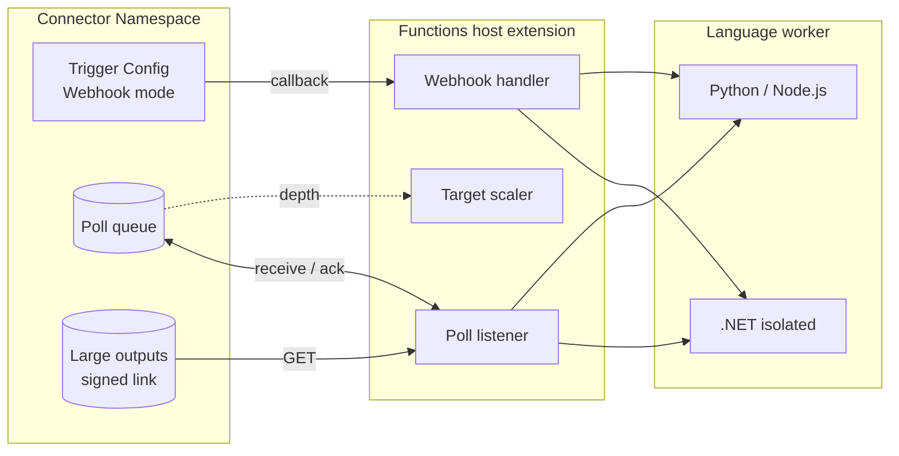
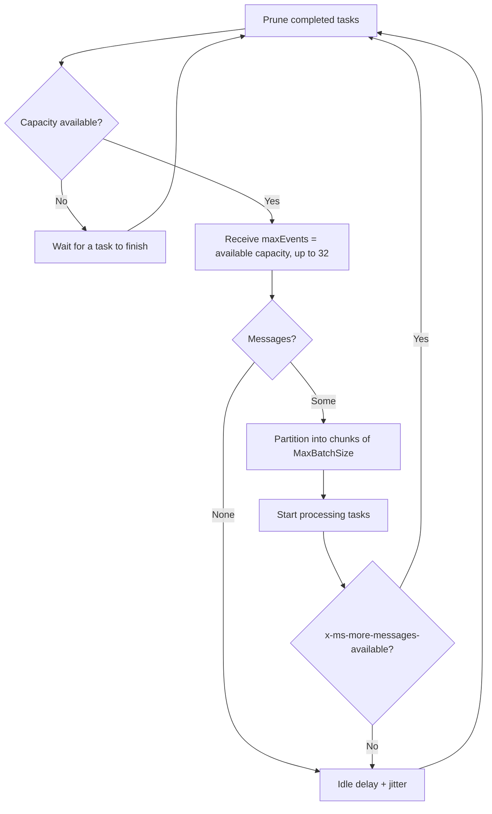

# Engineering the Azure Functions Connector Extension: From Webhooks to a Lease-Based Poll Runtime

*A technical deep dive into how the Connector extension was designed, built, hardened, and shipped as 1.0.0.*

---

## TL;DR

The Azure Functions Connector extension lets a function run when a Connector Namespace managed connector fires a trigger, such as a new Office 365 email, a new SharePoint file, or a Teams message. It ships as two NuGet packages, supports .NET isolated, Node.js/TypeScript, and Python, and offers two delivery modes:

| Delivery mode | Who initiates | Why you would pick it |
| --- | --- | --- |
| **Webhook** | Connector Namespace pushes an HTTP callback to the Function App. | Lowest latency; the original and default mode. |
| **Poll** | The Functions host leases messages from Connector Namespace and acknowledges them. | No public endpoint or dev tunnel, scale from zero, explicit at-least-once semantics. |

The interesting engineering is in Poll: a capacity-driven message pump, an all-or-none acknowledgement model, a host-wide limiter for large linked payloads, a target-based scaler, and a protocol layer deliberately shaped so it can later be extracted into a standalone Connectors Polling SDK.

---

## 1. The problem

Managed connectors already know how to detect "something happened" in hundreds of SaaS systems. Connector Namespace exposes those triggers as *Trigger Configs*. The extension's job is the last mile: turn a trigger output into a strongly typed function invocation, in any supported language, with the scaling and reliability guarantees that Azure Functions developers expect from first-party bindings such as Service Bus or Event Hubs.

Three constraints shaped every decision:

1. **The payload must be identical regardless of delivery mode.** An Office 365 `OnNewEmailV3` trigger produces the same `outputs` whether it arrives by Webhook or Poll. User code should never care.
2. **The work must happen in the host, not the language worker.** Doing acquisition, leasing, and acknowledgement in the WebJobs host extension means .NET, Python, Node.js, and generic `function.json` bindings all get identical behavior for free.
3. **Security is a first-class requirement, not a review step.** Tokens, lock tokens, payload bodies, and signed URLs are treated as secrets everywhere, including logs and exception messages.

---

## 2. How the project evolved

The Git history tells a clear story: ship a narrow, correct Webhook trigger first, invest in engineering infrastructure early, then design Poll on paper before writing it as a stack of reviewable pull requests.

| When | Milestone |
| --- | --- |
| Mar 2026 | Repository created. |
| Apr 2026 | Initial Webhook implementation (#4), CI/CD pipelines (#6), single-source version management (#9), and a Node.js/TypeScript sample (#10). |
| May 2026 | Rebranding to Connector Namespace (#15), SDK model packages (#16), Content-Type validation and Copilot skills (#18), and Python and Node samples with SDK-typed bindings (#19, #20). |
| Jun 2026 | Samples restructured into a test matrix and skills rewritten around the Connector Namespace CLI (#27). |
| Oct 2026 | Poll protocol foundation (#41), target-based scalers (#33), complete Poll delivery (#40), and the 1.0.0 hardening pass covering payload limits, stable endpoints, and Webhook sizing (#47). |
| Nov 2026 | Connector trigger payload reference across .NET, Python, and TypeScript (#53). |

The release notes for 1.0.0 summarize the result: the first stable release, supporting both Webhook and Poll delivery for the host extension and the .NET isolated worker extension.

---

## 3. Architecture at a glance



The repository contains two shipping packages and one shared contract:

| Component | Responsibility |
| --- | --- |
| `Microsoft.Azure.Functions.Extensions.Connector` | The WebJobs host extension: trigger binding, Webhook handler, Poll listener, protocol clients, and scaler. Loaded through extension bundles for non-.NET languages. |
| `Microsoft.Azure.Functions.Worker.Extensions.Connector` | The .NET isolated worker surface: `[ConnectorTrigger]`, `ConnectorEvent<T>`, and the input converter. |
| `src/Shared` | Compiled into both packages so the host-to-worker binding-data contract (`AzureConnectorEvent`, version `1.0`, and the `data`, `deliveryMode`, and `messageId` property names) can never drift. |

One deliberate structural decision: `ConnectorTriggerBinding.CreateListenerAsync` selects **either** `ConnectorListener` (Webhook) **or** `ConnectorPollingListener` (Poll). There is no single mode-switching listener. Each mode owns its lifecycle and its failure modes, and the Webhook path did not change when Poll was added.

The binding also implements `ITriggerBinding` directly instead of relying on obsolete WebJobs binding-strategy APIs, which keeps the trigger compatible with the modern deferred-binding pipeline.

---

## 4. The Webhook path: small, strict, and predictable

Webhook delivery is implemented as an `IAsyncConverter<HttpRequestMessage, HttpResponseMessage>` registered by `ConnectorExtensionConfigProvider`. The request processor is intentionally boring: it validates the request in a fixed order and maps each failure to a precise HTTP status before user code ever runs.

| Check | Failure response |
| --- | --- |
| Method is `POST` or `PUT` | `405 Method Not Allowed` |
| `Content-Type` is `application/json` | `415 Unsupported Media Type` |
| Body fits the host request limit | `413 Payload Too Large` |
| Body is well-formed JSON | `400 Bad Request` |
| Request is not cancelled | `408 Request Timeout` |
| Function invocation succeeds | Otherwise `500 Internal Server Error` |

Two details are worth calling out:

- **Size errors are found by walking the exception chain.** ASP.NET Core surfaces an oversized body as a `BadHttpRequestException` with status 413, sometimes wrapped. The processor walks `InnerException` until it finds that case, so the caller receives an accurate 413 rather than a generic 500.
- **Logging records shape, not content.** Debug logs include the function name, body length, and header *names*, never header values or the body.

Callback authentication uses the Functions system key passed as a `QueryString` parameter in the Trigger Config's `notificationDetails.authentication`, rather than embedding the key in the callback URL.

---

## 5. Why build Poll at all?

Webhooks are fast, but they have operational costs:

- Local development requires a public, authenticated dev tunnel.
- The Function App must expose an internet-reachable endpoint.
- Retry and delivery semantics are owned by the sender and are difficult to reason about from the receiving side.

Poll inverts the relationship. Connector Namespace enqueues trigger outputs and the Functions host *pulls* them using leased messages. That enables local development without a tunnel, private apps, explicit at-least-once semantics, and scaling driven by queue depth. It also made Poll the recommended starting point in the README, while Webhook remains the binding default for compatibility.

Poll is not a new event source. It is another delivery mode for the same trigger.

---

## 6. Design before code

Before the Poll implementation began, the team wrote a design document (`docs/connector-trigger-poll-delivery-design.md`) structured in three layers:

1. **Connector Namespace runtime contract**: the observed service protocol, documented exactly as it behaves.
2. **Proposed user contract**: what developers configure and what their functions receive.
3. **Internal architecture**: how the extension implements it.

Separating "what the service does" from "what we promise users" made it easy to spot where the extension would otherwise have invented semantics the service never offered. The document is explicit about non-goals: no exactly-once delivery, no client-configurable lock duration, no inferred lock expiration, and no URL construction from regional hostnames or resource identifiers.

The implementation then landed as stacked pull requests: protocol foundation, target-based scalers, and finally the listener and isolated-worker binding with cross-stack validation.

---

## 7. The Poll protocol

A Poll Trigger Config exposes opaque, server-generated endpoints. The extension uses three of them:

```http
GET  {pollingEndpoint}/api/triggerconfigs/{name}/receive?maxEvents=32
POST {pollingEndpoint}/api/triggerconfigs/{name}/acknowledge
GET  {pollingEndpoint}/api/triggerconfigs/{name}/approximateQueueDepth
```

All runtime calls authenticate with a `TokenCredential` token for `https://apihub.azure.com/.default`, and authorization comes from a connection-level access policy.

### Configuration that cannot be misused

Users configure a gateway-level `<Connection>__pollingEndpoint` and the binding supplies a `TriggerConfigName`. One shared endpoint builder accepts exactly two shapes: an HTTPS hostname-only endpoint, or a legacy base ending in `/api/connectorGateways/<gateway-id>`. It rejects query strings, user information, fragments, repeated trailing slashes, a standalone `/api`, or a path that already contains a Trigger Config or operation. The Trigger Config name is validated as exactly one path segment.

Invalid configuration fails at startup, **before** any token is acquired or request is sent. The host and gateway identifier are treated as opaque values and are never parsed, rewritten, or discovered.

### Wire DTOs versus protocol models

Every response is deserialized with `System.Text.Json` source generation (`ConnectorPollingJsonContext`) into **nullable wire DTOs**, then validated once into **immutable protocol models** such as `ConnectorPollMessage`, `ConnectorReceiveResult`, and `ConnectorAcknowledgeResult`. Nothing downstream ever sees an unvalidated message.

One invariant is enforced at this boundary: each message must contain **exactly one** of `outputs` or `outputsLink`.

| `outputs` | `outputsLink` | Result |
| --- | --- | --- |
| Present | Absent | Inline message |
| Absent | Present | Linked message |
| Present | Present | Protocol error |
| Absent | Absent | Protocol error |

Inline outputs are retained as owned `BinaryData` rather than a borrowed `JsonElement`, so a message's lifetime is never tied to the response buffer that produced it.

Unknown acknowledgement statuses are preserved as unsuccessful extensible string values. A future service status cannot break parsing of an entire acknowledgement response.

### No blind retries

Receive and Acknowledge are **not** transparently retried after ambiguous failures:

- A lost Receive response might already have leased messages.
- A lost Acknowledge response might already have deleted messages.

Retrying either operation could hide state changes and make the system harder to reason about. Unacknowledged messages simply become visible again after their lease expires. Runtime calls use a shared 30-second timeout, and linked-output downloads use a 2-minute timeout. Credential acquisition happens before the HTTP timeout starts.

### Bounded reads everywhere

Every response body is read with an *actual-bytes-read* limit rather than trusting `Content-Length`: 100 MiB for Receive and Acknowledge, 64 KiB for the queue-depth response, and the configurable linked-output limit for downloads.

---

## 8. Inside the message pump

`ConnectorPollingListener` owns exactly one message-pump task per listener instance. The core loop is *capacity-driven*: it never asks the service for more work than it can start immediately.



For a single-event listener, the capacity calculation is:

```csharp
int availableProcessingCapacity = effectiveMaxConcurrentCalls - activeProcessingTasks;
int maxEvents = Math.Min(32, availableProcessingCapacity);
```

A batched listener requests at most `MaxBatchSize` events and performs no further Receive until its current chunk is fully prepared, invoked, and acknowledged. This matters because **every received message is already leased**. Over-fetching would consume lease time on messages that are just waiting in memory.

### Three independent knobs

The public contract intentionally separates three settings that are often conflated:

| Setting | Controls | Default |
| --- | --- | --- |
| `MaxBatchSize` | Maximum events per invocation (1 to 32) | 1 |
| `MaxConcurrentCalls` | Active single-event tasks per listener per instance | 16 |
| `TargetPendingEventThreshold` | Desired pending events per instance, used **only** for scaling | 16 |

`MaxConcurrentCalls` applies only to single-event delivery, matching the Service Bus extension's single-message-only setting. A positive value on a batched binding is ignored and produces a startup warning rather than silently changing behavior. Effective values are validated against cardinality: a scalar parameter with an effective `MaxBatchSize` greater than 1 is rejected.

### Backoff that is gentle with the service

- An empty queue waits 1 second, plus up to 250 ms of jitter.
- A failed cycle starts at 1 second and doubles up to a 30-second ceiling, also with jitter.
- The failure backoff resets after every successful Receive.
- If the service reports `x-ms-more-messages-available` and capacity remains, the loop drains immediately.

Jitter prevents many scaled-out instances from synchronizing their polling after a shared outage.

### Lifecycle and shutdown

Start and Stop are serialized through a lifecycle semaphore, so a restart always waits for the previous pump to drain. Shutdown follows the host's `IDrainModeManager`:

- **Drain mode**: stop receiving, cancel idle waits immediately, and let in-flight invocations finish and acknowledge.
- **Otherwise**: cancel processing immediately and leave unfinished messages unacknowledged for redelivery.

The listener deliberately has no private grace timer. The host remains the single authority on shutdown policy. `Dispose` is idempotent, prevents future starts, and disposes cancellation sources only after the pump completes, which avoids a common class of `ObjectDisposedException` races.

---

## 9. Delivery semantics: honest at-least-once

The extension does not pretend to be stronger than the service.

- Delivery is **at least once**. Ordering is **not** guaranteed.
- A message's `messageId` is stable across redeliveries. Its `lockToken` changes with each delivery.
- Lock duration is service-owned and not returned to clients, so the extension **never infers a client-side deadline** and never invents a lock-renewal mechanism.
- **Acknowledgement is all-or-none per invocation.** If a batched function fails, every message in that invocation is left for redelivery. The extension cannot know which items completed before the exception, so it does not guess.

To make idempotency practical, users can opt into a metadata-rich envelope:

```csharp
[Function("OnNewEmail")]
public async Task Run(
    [ConnectorTrigger(
        Connection = "Office365",
        TriggerConfigName = "%EmailTriggerConfig%",
        DeliveryMode = ConnectorTriggerDeliveryMode.Poll,
        IsBatched = true,
        MaxBatchSize = 8)]
    ConnectorEvent<Office365OnNewEmailTriggerPayload>[] events)
{
    foreach (var e in events)
    {
        if (await _dedupe.TryMarkProcessedAsync(e.MessageId!))
        {
            await HandleAsync(e.Data);
        }
    }
}
```

`ConnectorEvent<T>` exposes only application-safe metadata. The `lockToken` is an acknowledgement capability and never leaves the host. Speculative fields such as `DeliveryAttempt` or `EnqueuedTime` were intentionally left out until the service defines them. The extension also never generates a replacement `MessageId` for Webhook delivery, because an invocation-local identifier would not remain stable across retries.

Per-event metadata follows the Kafka and Event Hubs pattern instead of parallel `messageIds[]` arrays, which become index-sensitive and fragile in batched invocations.

---

## 10. Large payloads and the linked-output limiter

Connector Namespace stores a trigger output inline only when the *entire encoded queue message* fits within the 64 KiB queue-storage limit. Larger outputs arrive as an `outputsLink`: a signed, time-limited HTTPS URI.

The extension normalizes both forms into the same `outputs` JSON before conversion, so user code never distinguishes between them. Getting there safely required several layers of defense.

**Treat the signed URI as a credential.**

- Never log, persist, or emit the full URI, and never include its query string in exceptions or telemetry.
- Require absolute HTTPS and reject user information and fragments.
- Do **not** attach the API Hub bearer token. The signature fully authorizes the request, and forwarding a bearer token to a content URL would leak it.
- Do not follow redirects.
- Use a dedicated, narrowly scoped linked-output client so no general-purpose client can accidentally add credentials.

**Bound the memory that one message can consume.**

- Enforce `MaxLinkedOutputSizeInBytes` while streaming. The default is 100 MiB, and there is no unlimited mode.
- Count bytes actually read, because the service does not return a content size.

**Bound the memory that many messages can consume.** Worker conversion is JSON-based, so a hydrated payload is materialized and then amplified by envelope construction and worker decoding. To keep that bounded, every linked message is invoked on its own, and a **process-wide singleton limiter** allows only one linked-output invocation at a time across *all* Connector Poll listeners in the host:

```csharp
internal sealed class ConnectorLinkedOutputInvocationLimiter
{
    private readonly SemaphoreSlim _semaphore = new(1, 1);

    internal async Task<IDisposable> AcquireAsync(CancellationToken cancellationToken)
    {
        await _semaphore.WaitAsync(cancellationToken).ConfigureAwait(false);
        return new Lease(_semaphore);
    }

    private sealed class Lease(SemaphoreSlim semaphore) : IDisposable
    {
        private SemaphoreSlim? _semaphore = semaphore;

        public void Dispose() => Interlocked.Exchange(ref _semaphore, null)?.Release();
    }
}
```

The lease is held from **before download** through **function execution and acknowledgement**, so a second large payload cannot be hydrated while the first is still live. The `Interlocked.Exchange` makes double disposal harmless.

The limiter is process-local by design. Each scaled-out instance has its own slot, so the system still parallelizes across instances without distributed coordination.

A smaller allocation optimization shipped in 1.0.0 as well: the deferred-binding envelope is written directly from the existing UTF-8 payload, avoiding an extra UTF-16 escaping buffer on the host.

---

## 11. Scaling from zero

A polling listener cannot poll when no instances are running. Poll therefore includes a **target-based scaler** (`ITargetScaler` / `ITargetScalerProvider`) that runs in the scale controller, separate from the listener and delivery client. The scaler reads approximate queue depth and computes:

```text
effectiveTarget   = TargetScalerContext.InstanceConcurrency ?? TargetPendingEventThreshold
targetWorkerCount = ceil(approximateQueueDepth / effectiveTarget)
```

This follows the same runtime-concurrency precedence used by Event Hubs and Service Bus. `MaxBatchSize` and `MaxConcurrentCalls` intentionally do not participate.

Two honest caveats are documented rather than hidden:

- Approximate depth counts both visible and leased messages and can lag. It is a scaling signal, not a count of immediately receivable work.
- The service also exposes a `hasMessages` endpoint, but the extension does not call it. Receive already returns `x-ms-more-messages-available`, and a preflight call would add latency and a time-of-check/time-of-use race.

---

## 12. Crossing the host-to-worker boundary

For .NET isolated apps, the worker package uses the modern **deferred binding** model. `ConnectorTriggerConverter` is marked `[SupportsDeferredBinding]` and receives either `ModelBindingData` for one event or `CollectionModelBindingData` for a batch. Each item carries the shared `AzureConnectorEvent` contract with `data`, `deliveryMode`, and, for Poll, `messageId`.

The converter remains **connector-agnostic**. It does not map Trigger Config names to SDK types. The function parameter's closed type is the source of truth:

| Parameter | Conversion |
| --- | --- |
| `T` | Deserialize one message's `outputs` into `T`. |
| `T[]` | Deserialize each message's `outputs` into `T`. |
| `ConnectorEvent<T>` | Deserialize into `Data` and attach `MessageId`. |
| `ConnectorEvent<T>[]` | Create one envelope per message. |

`T` can be a generated `Azure.Connectors.Sdk` payload type, `JsonElement`, `string`, or a custom POCO. Open generics such as `Run<T>(ConnectorEvent<T> e)` are unsupported because Functions must resolve concrete types at indexing time.

Node.js and Python consume the same host extension through extension bundles. Batching is enabled with `cardinality: "many"` in Node.js and `cardinality=func.Cardinality.MANY` with a `typing.List[str]` parameter in Python.

---

## 13. Security principles, collected

Security considerations are spread throughout this post. Here they are in one place:

1. **Validate at the boundary, once.** Configuration fails before credentials are used; wire DTOs are validated into immutable models.
2. **Secrets never reach logs.** This includes bearer tokens, lock tokens, payload bodies, signed URLs, and header values.
3. **Credentials stay scoped to their intended audience.** API Hub tokens go only to API Hub endpoints, never to signed content URLs.
4. **Every input is bounded.** Response sizes, batch sizes, linked-output sizes, and concurrency all have limits.
5. **Do not invent semantics.** The extension does not infer lock deadlines, guess partial success, generate fake identifiers, or apply retries that could hide state changes.
6. **Prefer allow-lists to parsing.** The extension accepts two exact endpoint shapes and treats everything inside them as opaque.

---

## 14. Testing strategy

Correctness is enforced at three levels:

- **Unit tests**: two test projects mirror the two packages, with more than 250 `[Fact]` and `[Theory]` cases. They cover protocol validation, endpoint parsing, listener concurrency and backoff, lifecycle races, acknowledgement mapping, scaler math, and worker conversion. Delays are injectable, so backoff and shutdown behavior can be tested deterministically without real sleeps.
- **Sample apps as a test matrix**: `test/webhook` and `test/poll` each contain .NET, Node.js, and Python apps built against the current checkout.
- **Regression coverage from the design document**: each documented invariant, such as "exactly one output source" or "acknowledge only after successful invocation", has a corresponding test.

---

## 15. Engineering infrastructure

Some of the most valuable work happened outside the runtime code:

- **One version source.** `eng/build/Version.props` drives both packages, and `get-package-version.yml` reads it in CI, so release metadata cannot drift.
- **Public and official pipelines.** `public-build.yml` validates pull requests, while `official-build.yml`, `official-release-host.yml`, and `official-release-worker.yml` sign and publish each package independently.
- **Shared MSBuild props and targets.** `Engineering.props`, `Release.props`, and `WebJobsReference.targets` keep both projects consistent.
- **Copilot skills as executable documentation.** Four repository skills (`connection-setup`, `webhook-trigger-registration`, `poll-trigger-registration`, and `operations-doc-update`) encode the multi-step Azure setup that would otherwise live only in tribal knowledge. They are used both by people and by AI agents working in the repository.
- **A payload reference that can be refreshed.** `docs/operations-functions-match.md` maps trigger operations to payload types across .NET, Python, and TypeScript, and the `operations-doc-update` skill keeps it current.

---

## 16. Lessons learned

1. **Write down the service contract separately from your promise.** Most design issues found during review were places where the extension would have promised more than the service guaranteed.
2. **Capacity-driven receive matters more than throughput tuning.** With leased messages, *when* you fetch matters as much as *how many* you fetch.
3. **Separate knobs by purpose.** Batch size, concurrency, and scale target answer different questions. Combining them would make every setting surprising.
4. **Global limits belong at the scope of the shared resource.** Memory is per process, so the linked-output limiter is per process, not per listener and not distributed.
5. **Design for extraction from the start.** Keeping the protocol client, listener, scaler, and endpoint configuration behind separate internal interfaces leaves a clean path to a standalone SDK.

---

## 17. What's next

- **Connectors Polling SDK.** Extract the transport, including authentication, HTTP operations, timeout and retry policy, serialization, and secret-safe errors, into an SDK. The extension would keep binding, lifecycle, concurrency, and batching.
- **Rich client bindings.** Bind directly to generated connector clients, similar to Storage client bindings.
- **Service-owned failure handling.** Integrate delivery count, dead-lettering, and failed-message observability after Connector Namespace publishes those contracts, without inferring them client-side.
- **Scaler failure semantics.** Distinguish "depth unavailable" from "empty queue" in the scale-controller contract ([#44](https://github.com/Azure/azure-functions-connector-extension/issues/44)).

---

## Further reading

- [Repository README](../../README.md)
- [Poll delivery design](../connector-trigger-poll-delivery-design.md)
- [Poll concurrency visual guide](../connector-poll-concurrency-visual-guide.md)
- [Trigger configuration reference](../connector-trigger-configuration.md)
- [Operations to Functions payload reference](../operations-functions-match.md)
- [Azure Functions connectors overview on Microsoft Learn](https://learn.microsoft.com/azure/azure-functions/functions-connectors-overview)
